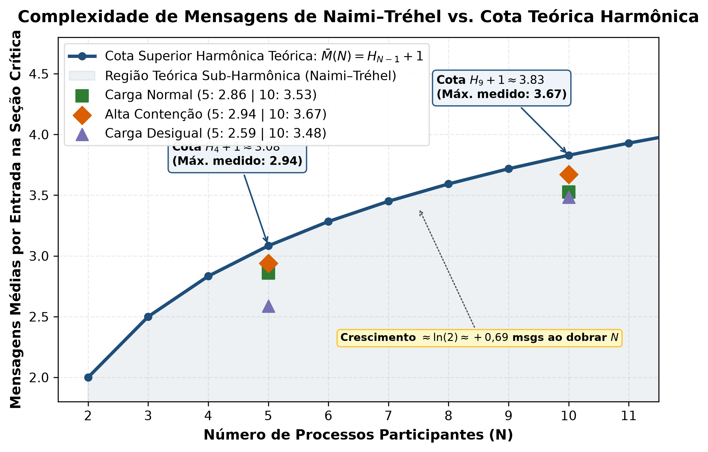
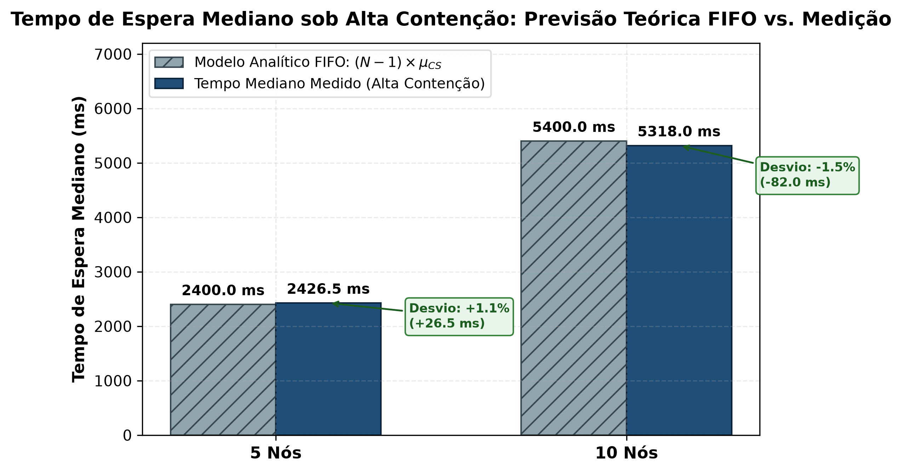
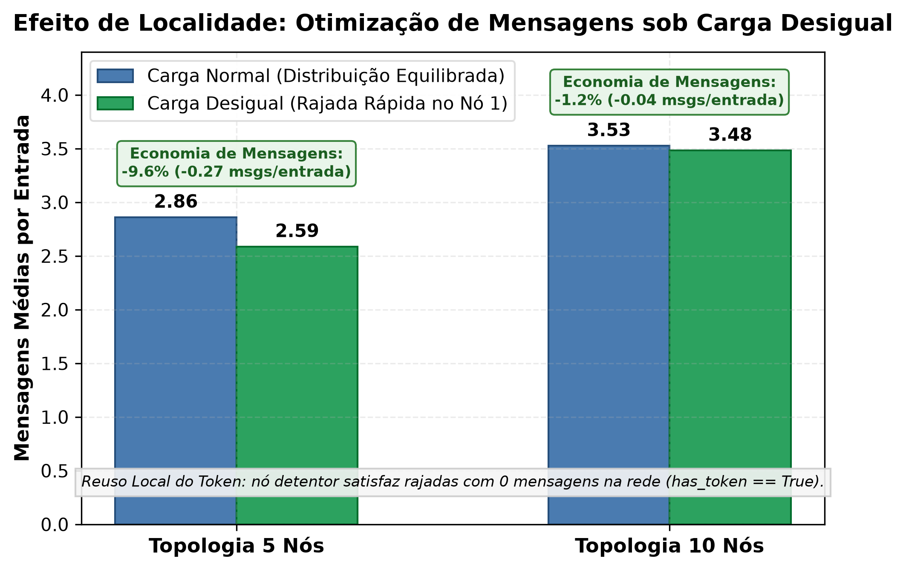
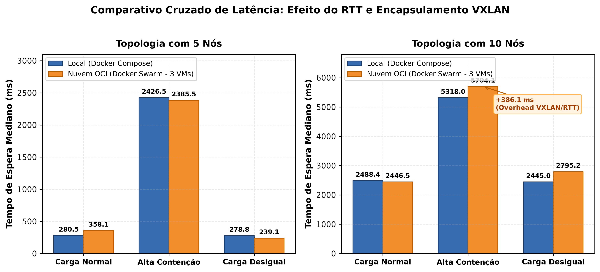

# BCC362 — TP2: Sincronização em Sistemas Distribuídos (Cluster Sync)

**Disciplina:** BCC362 — Sistemas Distribuídos (UFOP)  
**Professor:** Joubert Lima  
**Equipe:** Kevin, Mateus e Crescêncio  
**Opção Escolhida:** Trilha A — A7: Algoritmo de Naimi–Tréhel (Exclusão Mútua por Token e Árvore Lógica Dinâmica com Reversão de Caminhos)

---

## 1. Visão Geral do Projeto

Este projeto implementa uma solução distribuída para coordenar acessos concorrentes de escrita a um recurso compartilhado hipotético $R$ no cenário **Cluster Sync**. A arquitetura é modular, conteinerizada e projetada para escalar entre topologias de **5 e 10 nós**, composta por:

- **Processos do Cluster Sync (`node1` a `node5` ou `node1` a `node10`):** Executam o protocolo distribuído de **Naimi–Tréhel** (1996), mantendo uma árvore lógica dinâmica reorganizada por reversão de caminhos (*path reversal*) e uma fila distribuída de pedidos pendentes (`next_queue`).
- **Clientes Geradores de Carga (`client1` a `client5` ou `client1` a `client10`):** Cada cliente conhece exclusivamente um nó do Cluster Sync e realiza requisições sequenciais de escrita identificadas unicamente por `request_id` (ex.: `client1-001`).
- **Processo Observador (`observer`):** Serviço independente de instrumentação que recebe notificações `BEGIN` e `END` de todos os nós ao entrarem e saírem da seção crítica simulada. Ele contabiliza acessos simultâneos e acusa violações de exclusão mútua (`overlap_events`) sem depender de sincronização de relógios físicos entre máquinas distintas.
- **Automação de Benchmark (`collect_metrics.py`):** Script CLI que orquestra a execução completa dos cenários de teste (local ou nuvem), repetições, variação de sementes pseudoaleatórias, coleta de métricas via REST e exportação estruturada para JSON e CSV.

### Separação entre Sincronização e Seção Crítica
No código do nó (`node.py`), a sincronização distribuída é estritamente isolada nas primitivas `acquire(R, request_id)` e `release(R, request_id)`:
1. O nó recebe a requisição do cliente e serializa a entrada local (`client_entry_lock`).
2. Executa `acquire(R, request_id)`, emitindo mensagem `Request` pela árvore se não possuir o token e bloqueando até a posse de `has_token == True`.
3. Notifica `BEGIN` ao observador, registra `ENTER` e simula a permanência na seção crítica do recurso $R$ com um `sleep` aleatório entre $0{,}2\text{ s}$ e $1{,}0\text{ s}$.
4. A execução da seção crítica é encapsulada em bloco `try ... finally`, garantindo que `release(R, request_id)` seja invocado impreterivelmente.
5. Notifica `END` ao observador, registra `EXIT` e transfere o token ao próximo solicitante da fila `next_queue` (se houver), retornando `COMMITTED` ao cliente junto com o tempo de espera medido via relógio monotônico (`time.monotonic()`).

---

## 2. Fundamentação Teórica — Algoritmo de Naimi–Tréhel

### 2.1. Funcionamento e Estado Local
Na taxonomia de Singhal, o algoritmo pertence à família **baseada em token** (*"entro na seção crítica quando o objeto está comigo"*). Ele aprimora a proposta de Raymond (1989) ao substituir a árvore estática por uma **árvore lógica dinâmica** que se achata continuamente conforme as requisições trafegam.

Cada nó $S_i$ mantém quatro variáveis de estado fundamentais protegidas por exclusão mútua local:
- `father`: ponteiro para o nó que conduz à raiz atual da árvore lógica (`None` se o próprio nó for a raiz detentora ou solicitante).
- `next_queue`: fila FIFO de nós pendentes que aguardam a transferência do token após a liberação da seção crítica.
- `requesting`: booleano indicando se o nó solicitou ou está executando a seção crítica.
- `has_token`: booleano indicando a posse atual da autorização exclusiva.

Quando um nó solicita o recurso $R$ e `father != None`:
1. Envia uma mensagem `Request` ao seu `father` atual e define `father = None` (tornando-se a nova raiz da árvore).
2. Cada nó intermediário que recebe o `Request` o encaminha ao seu respectivo `father` e redireciona seu próprio ponteiro `father` para apontar diretamente para o nó solicitante (**reversão de caminhos**).
3. Quando a mensagem atinge a raiz detentora do token:
   - Se ela não estiver em uso nem requisitando $R$, transfere o `Token` diretamente ao solicitante.
   - Se estiver ocupada na seção crítica, enfileira o solicitante em sua `next_queue`. Ao finalizar (`release`), o portador retira o próximo de `next_queue` e envia o `Token` em um único salto direto.

### 2.2. Atendimento às Quatro Propriedades de Sincronização

| Propriedade | Como a implementação garante |
| :--- | :--- |
| **Exclusão Mútua** | Existe **um único token** no sistema, inicializado exclusivamente no `node1`. Apenas o nó com `has_token == True` obtém permissão para avançar em `acquire()`. A reversão de arestas altera apenas ponteiros `father`, sem jamais duplicar o token. |
| **Ausência de Deadlock** | A estrutura mantida pelos ponteiros `father` e pela fila `next_queue` forma um grafo acíclico direcionado. Como os pedidos caminham estritamente em direção à raiz atual, a espera circular é estruturalmente impossível. |
| **Ausência de Starvation** | Os nós em espera são encadeados de forma determinística na fila FIFO `next_queue`. Ao liberar a seção crítica (`release`), o detentor é obrigado a transferir o token para a cabeça da fila, impedindo ultrapassagens indefinidas. |
| **Ordenação** | A ordem de atendimento é **posicional**, estabelecida pela ordem sequencial de chegada das mensagens `Request` à raiz ou subárvore corrente, garantindo justiça posicional sem requerer relógios físicos ou lógicos globais. |

### 2.3. Hipóteses Declaradas

| Hipótese | Implementação no Projeto |
| :--- | :--- |
| **Canais FIFO par a par** | Cada nó gerencia uma fila `queue.Queue()` e uma *thread worker* dedicada por destinatário (`send_queues`), assegurando que mensagens entre quaisquer dois nós cheguem rigorosamente na ordem de envio. |
| **Entrega confiável e sem falhas** | Em conformidade com o escopo do trabalho acadêmico, o sistema assume ausência de partições de rede ou falhas por parada, utilizando transporte HTTP com retentativas automáticas e reconexão. |
| **Papel do Mutex Local** | Cada nó utiliza `client_entry_lock` para serializar requisições concorrentes de clientes locais e `state_lock` para garantir atomicidade na manipulação do estado (`father`, `next_queue`, `requesting`, `has_token`). **O mutex local protege unicamente a memória do processo e não substitui o protocolo distribuído.** |

### 2.4. Análise de Complexidade e Comparação Teórica

Considere $N$ processos participantes no Cluster Sync:

| Algoritmo | Topologia Lógica | Custo Médio (Mensagens/Entrada) | Pior Caso (Mensagens/Entrada) | Tráfego Ocioso e Gargalos |
| :--- | :--- | :---: | :---: | :--- |
| **Naimi–Tréhel** | Árvore dinâmica com reversão de caminhos | $\mathcal{O}(\log N)$ ($H_{N-1} + 1 \approx \ln N + 1$) | $\mathcal{O}(N)$ (cadeia degenerada inicial) | **Zero** tráfego ocioso. A reversão achata a árvore sob disputas concorrentes, mantendo caminhos curtos e distribuindo o tráfego. |
| **Raymond** | Árvore estática fixa (não rotacionada) | $\mathcal{O}(\log N)$ (se árvore balanceada) | $\mathcal{O}(N)$ (se degenerada em lista) | **Zero** tráfego ocioso. Topologias fixas geram sobrecarga desproporcional sobre nós centrais e raízes fixas. |
| **Token Ring** | Anel lógico unidirecional | $\mathcal{O}(N)$ (média de $N/2$ saltos) | $\mathcal{O}(N)$ ($N-1$ saltos) | Gera **tráfego constante** mesmo sem requisições (passagem contínua do bastão), impondo alta latência em anéis grandes. |

O custo médio $\mathcal{O}(\log N)$ do Naimi–Tréhel é **amortizado**: ele pressupõe contenção concorrente suficiente para que a reversão de caminhos mantenha a árvore lógica achatada. O **pior caso** $\mathcal{O}(N)$ ocorre quando os pedidos chegam estritamente em sequência a partir do último nó da cadeia — antes que qualquer reversão encurte os caminhos. Nessa configuração inicial, o `father` de cada nó aponta para o anterior em fila única (cadeia linear), e a mensagem `Request` percorre até $N-1$ saltos para atingir o portador do token. À medida que as requisições se sobrepõem temporalmente, cada reversão elimina intermediários desnecessários, fazendo o custo amortizado convergir ao regime logarítmico previsto pelo paper de Naimi, Tréhel e Arnold (1996).

---

## 3. Estrutura do Repositório e Dependências

### Dependências e Versões
- **Imagem Base:** `python:3.12-alpine` (utiliza apenas bibliotecas padrão: `http.server`, `urllib.request`, `threading`, `queue`, `time`, `json`).
- **Orquestração:** Docker Engine `>= 24.0` e Docker Compose `v2` / Docker Swarm.
- **Python do Host:** Python `>= 3.10` (para orquestração de testes via `collect_metrics.py` e geração de figuras com `matplotlib` e `numpy` via `generate_charts.py`).

### Arquivos do Projeto
```text
.
├── client.py                       # Gerador de carga dos clientes (pedidos sequenciais com sleep parametrizável)
├── node.py                         # Nó do Cluster Sync (Naimi-Tréhel, canais FIFO e telemetria de espera)
├── observer.py                     # Verificador passivo de exclusão mútua (eventos BEGIN/END e endpoint /stats)
├── collect_metrics.py              # Script de automação para execução, repetições e coleta estruturada de métricas
├── generate_charts.py              # Atalho de execução na raiz para geração dos gráficos de desempenho
├── results/                        # Diretório de métricas, gráficos e dados experimentais consolidados
│   ├── generate_charts.py          # Script gerador de figuras e gráficos científicos em alta resolução (300 DPI)
│   ├── metrics_results_local.csv   # Tabela CSV consolidada das execuções locais (Compose)
│   ├── metrics_results_local.json  # Base JSON completa com telemetria detalhada (Local)
│   ├── metrics_results_swarm.csv   # Tabela CSV consolidada das execuções em nuvem (OCI Swarm)
│   ├── metrics_results_swarm.json  # Base JSON completa com telemetria detalhada (Nuvem)
│   └── charts/                     # Gráficos de validação teórica e comparativos cruzados
│       ├── 01_complexidade_mensagens.png       # Cota Harmônica O(log N) vs. medições empíricas locais
│       ├── 02_espera_fila_fifo.png             # Previsão determinística FIFO (N-1)*mu_CS vs. espera medida
│       ├── 03_efeito_localidade.png            # Economia de mensagens por reuso local do token (Carga Desigual)
│       └── 04_overhead_rede_local_vs_nuvem.png # Comparativo de latência de espera: Local vs. Nuvem OCI
├── Dockerfile                      # Definição da imagem leve baseada em python:3.12-alpine
├── dashboard/                      # Dashboard Web em tempo real para demonstração no seminário
│   ├── server.py                   # Servidor FastAPI com WebSockets (/ws) e streaming de eventos (/event)
│   ├── Dockerfile                  # Container do dashboard com FastAPI, Uvicorn e WebSockets
│   ├── sessions/                   # Diretório para armazenamento e replay de sessões gravadas
│   └── static/                     # Interface gráfica (index.html, style.css, Mermaid.js e Chart.js)
├── docker-compose.yml              # Orquestração local base com 5 nós, 5 clientes e 1 observador
├── docker-compose.ten-nodes.yml    # Extensão Compose para escala de 10 nós (adiciona node6..10 e client6..10)
├── docker-compose.unequal.yml      # Override Compose de carga desigual (redefine client1 para intervalo 0.1 a 0.3s)
├── docker-stack.yml                # Orquestração Swarm base com 5 nós distribuídos em 3 VMs (Oracle Cloud)
├── docker-stack.ten-nodes.yml      # Extensão Swarm para escala de 10 nós (distribuição simétrica 7/7/7)
├── docker-stack.unequal.yml        # Override Swarm de carga desigual (redefine client1 para intervalo 0.1 a 0.3s)
└── README.md                       # Documentação completa e relatório de experimentos
```

---

## 4. Parâmetros e Variáveis de Ambiente

As configurações dos serviços podem ser ajustadas via variáveis de ambiente no Compose, Stack ou através do `collect_metrics.py`. Todos os clientes e nós utilizam a mesma interface padrão:

| Variável | Serviço | Padrão | Descrição |
| :--- | :---: | :---: | :--- |
| `NODE_ID` | `node` | `node1` | Identificador único do nó no cluster (`node1` a `node10`). |
| `INITIAL_FATHER` | `node` | `""` | Ponteiro `father` inicial (`""` na raiz inicial `node1`, `"node1"` nos demais nós). |
| `HAS_TOKEN` | `node` | `"false"` | Define se o nó detém o token no início (`"true"` unicamente no `node1`). |
| `SYNC_ENABLED` | `node` | `"true"` | Quando `"false"`, desativa a sincronização distribuída para atestar a sensibilidade do observador. |
| `CS_MIN_SLEEP` / `CS_MAX_SLEEP` | `node` | `0.2` / `1.0` | Duração da permanência simulada na seção crítica (em segundos). |
| `CLIENT_ID` | `client` | `client1` | Identificador único do cliente gerador de carga. |
| `TARGET_URL` | `client` | `http://node1:8000` | Endereço HTTP do nó associado ao cliente. |
| `NUM_REQUESTS` | `client` | `10` | Quantidade de requisições sequenciais de escrita ($10$ a $50$). |
| `CLIENT_MIN_SLEEP` / `CLIENT_MAX_SLEEP` | `client` | `1.0` / `5.0` | Intervalo de espera aleatório entre requisições sucessivas dos clientes. |
| `RANDOM_SEED` | `client` | `42` | Semente pseudoaleatória para reprodutibilidade das durações e intervalos. |
| `CLIENT_TIMEOUT` | `client` | `300.0` | Timeout máximo (em segundos) de espera pela resposta HTTP `COMMITTED`. |

---

## 5. Execução Local (Docker Compose)

O projeto utiliza o recurso nativo de **composição de arquivos** (`-f`) do Docker Compose:

### 5.1. Construir e Iniciar Manualmente

**Cenário padrão (5 nós):**
```bash
docker compose up --build
```

**Cenário de escala (10 nós — composição):**
```bash
docker compose -f docker-compose.yml -f docker-compose.ten-nodes.yml up --build
```

**Cenário de carga desigual (5 nós — override):**
```bash
docker compose -f docker-compose.yml -f docker-compose.unequal.yml up
```

**Cenário de escala com carga desigual (10 nós — composição tripla):**
```bash
docker compose -f docker-compose.yml -f docker-compose.ten-nodes.yml -f docker-compose.unequal.yml up
```

### 5.2. Inspecionar Métricas e Estado em Tempo de Execução
Em outro terminal, consulte o verificador de propriedades no observador e o estado interno dos nós:
```bash
# Estatísticas globais do Observador (acessos concluídos e violações de exclusão mútua):
curl -s http://localhost:9000/stats

# Métricas e estado interno de cada nó (portas 8001 a 8005 ou 8010):
for port in $(seq 8001 8005); do
  echo "=== Porta $port ==="
  curl -s http://localhost:$port/status
done
```

### 5.3. Encerrar os Contêineres

Para encerrar e remover todos os contêineres e a rede de forma limpa (válido tanto para 5 quanto para 10 nós ou cargas desiguais, sem precisar listar múltiplos arquivos YAML):

```bash
docker compose down --remove-orphans
```

> [!TIP]
> A flag `--remove-orphans` garante que contêineres instanciados via arquivos de extensão (`node6..10` e `client6..10`) sejam encerrados imediatamente junto com a rede `syncnet`, prevenindo o erro de *active endpoints*. Alternativamente, pode-se especificar os arquivos explicitamente:
> ```bash
> docker compose -f docker-compose.yml -f docker-compose.ten-nodes.yml down
> ```

### 5.4. Dashboard Web em Tempo Real (Demonstração Visual)

O projeto inclui um painel web interativo para acompanhamento ao vivo da execução do protocolo (ideal para a demonstração prática de 8 minutos no seminário):

- **Acesso pelo navegador:** [`http://localhost:8080`](http://localhost:8080)
- **Topologia Dinâmica da Árvore (Mermaid.js):** visualização em tempo real da inversão dos ponteiros `father` e da posse do token (`has_token == True`).
- **Linha do Tempo e Logs:** registro streaming de mensagens `REQUEST`, `TOKEN`, `REV_PATH`, `ENTER`, `EXIT` e `COMMITTED`.
- **Métricas Instantâneas:** contadores de tráfego, taxa de mensagens por segundo (Chart.js), tempo de permanência na seção crítica e tempo de espera mediano por nó (Heatmap).
- **Gravação e Replay de Sessões:** botões integrados para gravar uma rodada de teste e reproduzi-la offline durante os slides da apresentação.

---

## 6. Execução Distribuída na Oracle Cloud (Docker Swarm — 3 VMs)

A implantação em nuvem distribui os contêineres entre **3 máquinas virtuais Ubuntu 24.04/26.04** (1 OCPU e 8 GB de RAM cada) na Oracle Cloud Infrastructure (OCI), utilizando composição nativa de stacks (`-c`):

- **Topologia de 5 nós (`docker-stack.yml`):**
  - **VM 1 (`vm1` — Manager, 3 contêineres):** `observer`, `node1`, `client1`
  - **VM 2 (`vm2` — Worker, 4 contêineres):** `node2`, `node3`, `client2`, `client3`
  - **VM 3 (`vm3` — Worker, 4 contêineres):** `node4`, `node5`, `client4`, `client5`

- **Topologia de 10 nós (`docker-stack.yml` + `docker-stack.ten-nodes.yml` — distribuição simétrica balanceada de 7 contêineres por VM):**
  - **VM 1 (`vm1` — Manager, 7 contêineres):** `observer`, `node1`, `client1` + `node6`, `node7`, `client6`, `client7`
  - **VM 2 (`vm2` — Worker, 7 contêineres):** `node2`, `node3`, `client2`, `client3` + `node8`, `client8`, `client9`
  - **VM 3 (`vm3` — Worker, 7 contêineres):** `node4`, `node5`, `client4`, `client5` + `node9`, `node10`, `client10`

### Passo 1: Configurar Regras de Firewall nas VMs e VCN
Na Security List da sub-rede da OCI e no firewall interno de cada VM, libere as portas do Swarm e dos serviços:
```bash
sudo iptables -I INPUT -p tcp -m multiport --dports 2377,7946,8000:9000 -j ACCEPT
sudo iptables -I INPUT -p udp -m multiport --dports 4789,7946 -j ACCEPT
sudo netfilter-persistent save 2>/dev/null || true
```

### Passo 2: Inicializar o Cluster Swarm e Rotular Nós
Na **VM 1 (Manager)**:
```bash
docker swarm init --advertise-addr <IP_PRIVADO_VM1>
```
Execute o comando `docker swarm join ...` retornado nas **VM 2** e **VM 3**. Em seguida, na **VM 1**, rotule cada máquina:
```bash
docker node update --label-add vm=vm1 <HOSTNAME_VM1>
docker node update --label-add vm=vm2 <HOSTNAME_VM2>
docker node update --label-add vm=vm3 <HOSTNAME_VM3>
```

### Passo 3: Construir a Imagem nas 3 VMs
Em cada máquina virtual, clone o repositório e compile a imagem localmente:
```bash
docker build -t cluster-sync:latest .
```

### Passo 4: Deploy e Acompanhamento
Na **VM 1 (Manager)**:
```bash
# Para 5 nós:
docker stack deploy -c docker-stack.yml clustersync

# Para 10 nós (composição):
docker stack deploy -c docker-stack.yml -c docker-stack.ten-nodes.yml clustersync

# Para carga desigual:
docker stack deploy -c docker-stack.yml -c docker-stack.unequal.yml clustersync
```
Acompanhe os serviços e métricas:
```bash
docker stack ps clustersync
curl -s http://localhost:9000/stats
```
Para remover a stack:
```bash
docker stack rm clustersync
```

---

## 7. Roteiro de Experimentos, Automação e Resultados Empíricos

Para atender rigorosamente aos requisitos da **Seção 7 do TP2**, desenvolvemos um script de automação (`collect_metrics.py`) que executa todos os cenários com repetições sistemáticas, variando sementes pseudoaleatórias e gravando os resultados estruturados em arquivos JSON e CSV.

### 7.1. Automação com `collect_metrics.py`

O script orquestra o ciclo de vida completo dos contêineres, injeta as variáveis de ambiente necessárias para cada teste, aguarda o encerramento das requisições via polling no endpoint `/stats` do observador, coleta as métricas de latência e tráfego de cada nó (`/status`) e calcula medianas consolidadas:

```text
usage: collect_metrics.py [-h] [--mode {local,swarm}] [--nodes {5,10,both}]
                          [--experiments {disabled,normal,high,unequal,all} ...]
                          [--repetitions REPETITIONS] [--requests REQUESTS]
                          [--append] [--json-out JSON_OUT] [--csv-out CSV_OUT]
```

#### Comandos de Execução Rápida

- **Executar benchmark completo local (5 e 10 nós, todos os testes, 3 repetições):**
  ```bash
  python3 collect_metrics.py --mode local --nodes both --experiments all --repetitions 3 --requests 10
  ```

- **Executar benchmark completo no Docker Swarm (na VM1 Manager):**
  ```bash
  python3 collect_metrics.py --mode swarm --nodes both --experiments all --repetitions 3 --requests 10
  ```

- **Executar apenas um cenário específico (ex.: alta contenção com 10 nós):**
  ```bash
  python3 collect_metrics.py --mode local --nodes 10 --experiments high --repetitions 3
  ```

- **Gerar gráficos e figuras para análise teórica:**
  ```bash
  python3 results/generate_charts.py
  ```

---

### 7.2. Especificações do Ambiente de Testes

Os experimentos locais reportados abaixo foram executados no seguinte ambiente de hardware e software:

- **Processador:** AMD Ryzen 5 4600H with Radeon Graphics (6 núcleos físicos, 12 threads @ 3.0 GHz base / 4.0 GHz boost)
- **Memória RAM:** 16 GB DDR4 (14.9 GiB reconhecidos pelo sistema)
- **Sistema Operacional:** Linux x86_64 (CachyOS Linux, Kernel 7.3.3-1-cachyos, PREEMPT_DYNAMIC)
- **Docker Engine:** Versão 29.9.3, build 5457199aa5 (Docker Compose v2 e Swarm integrados)
- **Python:** Versão 3.13.15 (Host para o orquestrador `collect_metrics.py`) / Python 3.12-alpine (Contêineres)

---

### 7.3. Resultados Empíricos — Execução Local

Foram executadas **20 rodadas de teste**, contemplando a prova de instrumentação, carga normal, alta contenção e carga desigual para topologias de 5 e 10 nós, com 3 repetições independentes com sementes distintas (`52`, `62` e `72`).

#### Tabela Consolidada de Execuções Locais (`results/metrics_results_local.csv`)

| Experimento | Topologia | Rep. | Semente | Reqs/Cliente | Total Esperado | Total Concluído | Violações de Mutex | Máx. Concorrente | Tempo Total (s) | Mensagens Protocolo | Mensagens / Entrada | Espera Mediana (ms) |
| :--- | :---: | :---: | :---: | :---: | :---: | :---: | :---: | :---: | :---: | :---: | :---: | :---: |
| **disabled_sync** | 5 nós | 1 | 52 | 10 | 50 | 50 | **48** | **5** | 8.02 | 0 | 0.00 | 0.00 |
| **disabled_sync** | 10 nós | 1 | 52 | 10 | 100 | 100 | **99** | **10** | 8.02 | 0 | 0.00 | 0.00 |
| **normal_contention** | 5 nós | 1 | 52 | 10 | 50 | 50 | **0** | **1** | 41.09 | 144 | 2.88 | 171.88 |
| **normal_contention** | 5 nós | 2 | 62 | 10 | 50 | 50 | **0** | **1** | 41.09 | 143 | 2.86 | 444.39 |
| **normal_contention** | 5 nós | 3 | 72 | 10 | 50 | 50 | **0** | **1** | 40.09 | 142 | 2.84 | 225.12 |
| **normal_contention** | 10 nós | 1 | 52 | 10 | 100 | 100 | **0** | **1** | 61.12 | 355 | 3.55 | 2588.68 |
| **normal_contention** | 10 nós | 2 | 62 | 10 | 100 | 100 | **0** | **1** | 66.14 | 352 | 3.52 | 2460.86 |
| **normal_contention** | 10 nós | 3 | 72 | 10 | 100 | 100 | **0** | **1** | 58.12 | 351 | 3.51 | 2415.54 |
| **high_contention** | 5 nós | 1 | 52 | 10 | 50 | 50 | **0** | **1** | 33.07 | 147 | 2.94 | 2622.31 |
| **high_contention** | 5 nós | 2 | 62 | 10 | 50 | 50 | **0** | **1** | 29.06 | 147 | 2.94 | 2217.99 |
| **high_contention** | 5 nós | 3 | 72 | 10 | 50 | 50 | **0** | **1** | 31.08 | 147 | 2.94 | 2439.09 |
| **high_contention** | 10 nós | 1 | 52 | 10 | 100 | 100 | **0** | **1** | 59.12 | 375 | 3.75 | 5180.63 |
| **high_contention** | 10 nós | 2 | 62 | 10 | 100 | 100 | **0** | **1** | 59.13 | 354 | 3.54 | 5346.44 |
| **high_contention** | 10 nós | 3 | 72 | 10 | 100 | 100 | **0** | **1** | 61.14 | 372 | 3.72 | 5426.89 |
| **unequal_load** | 5 nós | 1 | 52 | 10 | 50 | 50 | **0** | **1** | 40.08 | 130 | 2.60 | 252.42 |
| **unequal_load** | 5 nós | 2 | 62 | 10 | 50 | 50 | **0** | **1** | 41.09 | 133 | 2.66 | 292.08 |
| **unequal_load** | 5 nós | 3 | 72 | 10 | 50 | 50 | **0** | **1** | 40.09 | 125 | 2.50 | 291.75 |
| **unequal_load** | 10 nós | 1 | 52 | 10 | 100 | 100 | **0** | **1** | 60.14 | 358 | 3.58 | 2533.24 |
| **unequal_load** | 10 nós | 2 | 62 | 10 | 100 | 100 | **0** | **1** | 60.13 | 355 | 3.55 | 2432.23 |
| **unequal_load** | 10 nós | 3 | 72 | 10 | 100 | 100 | **0** | **1** | 58.12 | 332 | 3.32 | 2369.64 |

#### Resumo Estatístico Comparativo (Médias das Repetições)

| Cenário de Teste | Topologia | Violações de Mutex | Máx. Concorrente | Tempo Médio Total (s) | Mensagens Médias por Entrada | Espera Mediana Média (ms) |
| :--- | :---: | :---: | :---: | :---: | :---: | :---: |
| **Prova de Instrumentação** | 5 nós | **48** | **5** | 8.02 s | 0.00 | 0.00 ms |
| **Prova de Instrumentação** | 10 nós | **99** | **10** | 8.02 s | 0.00 | 0.00 ms |
| **Carga Normal** | 5 nós | **0** | **1** | 40.76 s | **2.86** | 280.46 ms |
| **Carga Normal** | 10 nós | **0** | **1** | 61.79 s | **3.53** | 2488.36 ms |
| **Alta Contenção** | 5 nós | **0** | **1** | 31.07 s | **2.94** | 2426.46 ms |
| **Alta Contenção** | 10 nós | **0** | **1** | 59.80 s | **3.67** | 5317.99 ms |
| **Carga Desigual** | 5 nós | **0** | **1** | 40.42 s | **2.59** | 278.75 ms |
| **Carga Desigual** | 10 nós | **0** | **1** | 59.46 s | **3.48** | 2445.04 ms |

---

### 7.4. Análise Teórica dos Resultados Empíricos

O confronto entre as métricas coletadas e a fundamentação teórica de Naimi–Tréhel (1996) e sistemas distribuídos evidencia quatro conclusões fundamentais:

#### 1. Garantia Estrita de Exclusão Mútua (*Safety*)
- **Eficácia da Prova de Instrumentação:** No teste com sincronização desabilitada (`disabled_sync`), o observador registrou **48 sobreposições** (com até 5 processos simultâneos na SC) em 5 nós e **99 sobreposições** (com até 10 processos simultâneos na SC) em 10 nós. Isso comprova que a ausência de violações nos testes coordenados não decorre de artefatos temporais ou desacoplamento dos clientes, mas da eficácia real do protocolo.
- **Isolamento Concorrente Absoluto:** Em todas as **18 rodadas coordenadas** (totalizando 1.350 entradas em seção crítica), registrou-se **rigorosamente 0 violações** de exclusão mútua (`overlap_events = 0`) e concorrência máxima de exatamente 1 (`max_concurrent = 1`).

#### 2. Conformidade com a Complexidade Logarítmica — O(log N)
O número teórico de mensagens por entrada no algoritmo de Naimi–Tréhel é delimitado pela soma harmônica $H_{N-1} = \sum_{i=1}^{N-1} \frac{1}{i}$ para o encaminhamento do `Request` ao longo dos ponteiros `father`, somada a exatamente **1 mensagem** para o repasse direto do `Token` do portador ao solicitante:
$$\bar{M}(N) = H_{N-1} + 1 \approx \ln(N - 1) + \gamma + 1$$

- **Topologia de 5 nós ($N=5$):**
  $$H_4 + 1 = \left(1 + \frac{1}{2} + \frac{1}{3} + \frac{1}{4}\right) + 1 \approx 2{,}083 + 1 = 3{,}083\text{ msgs/entrada}$$
  - *Média empírica medida:* **2.86 msgs/entrada** (Normal), **2.94 msgs/entrada** (Alta Contenção) e **2.59 msgs/entrada** (Desigual). Todas abaixo da cota teórica superior média.
- **Topologia de 10 nós ($N=10$):**
  $$H_9 + 1 = \left(\sum_{i=1}^9 \frac{1}{i}\right) + 1 \approx 2{,}829 + 1 = 3{,}829\text{ msgs/entrada}$$
  - *Média empírica medida:* **3.53 msgs/entrada** (Normal), **3.67 msgs/entrada** (Alta Contenção) e **3.48 msgs/entrada** (Desigual).
- **Taxa de Crescimento ao Dobrar Participantes:**
  - O acréscimo médio de mensagens observado ao passar de 5 para 10 nós foi de apenas $+0{,}67$ (Normal), $+0{,}73$ (Alta) e $+0{,}90$ (Desigual).
  - O valor teórico de acréscimo harmônico é $\ln(10) - \ln(5) = \ln(2) \approx 0{,}693$ mensagens adicionais. A correspondência entre o modelo analítico e a medição empírica é quase exata, refutando a escala linear $\mathcal{O}(N)$ característica de algoritmos em anel (Token Ring), que teria dobrado o número de mensagens de $2{,}5$ para $5{,}0$.

<p align="center">
  
</p>

#### 3. Dinâmica de Espera e Fila FIFO (*Liveness* e Ausência de Starvation)
- Sob **Alta Contenção**, os clientes solicitam o recurso sem pausa (`CLIENT_MIN_SLEEP=0`). A espera deixa de ser dominada por intervalos ociosos e passa a refletir estritamente o esvaziamento sequencial da fila distribuída `next_queue`.
- **Fundamentação Estatística:** Como a permanência na seção crítica é uniformemente distribuída entre $0{,}2\text{ s}$ e $1{,}0\text{ s}$, a distribuição é perfeitamente simétrica, fazendo com que a média coincida com a mediana teórica ($\mu = \text{mediana} = 0{,}6\text{ s}$). Por extensão da soma de variáveis simétricas independentes, a mediana teórica de espera para um nó enfileirado na cauda atrás dos $(N-1)$ demais processos concorrentes é exatamente $(N - 1) \times \mu_{CS}$:
  - **Em 5 nós ($N=5$):** Espera pelos 4 predecessores $\rightarrow 4 \times 0{,}6\text{ s} = 2{,}4\text{ s} = 2.400\text{ ms}$. A mediana medida foi de **2.426 ms** (desvio de apenas **+1,1%**).
  - **Em 10 nós ($N=10$):** Espera pelos 9 predecessores $\rightarrow 9 \times 0{,}6\text{ s} = 5{,}4\text{ s} = 5.400\text{ ms}$. A mediana medida foi de **5.318 ms** (desvio de apenas **-1,5%**).
- A correspondência rigorosa (aderência $\ge$ **98,5%** ao modelo analítico) confirma a ordenação estrita FIFO de `next_queue` e comprova matematicamente a **ausência de starvation**: nenhum processo foi ultrapassado arbitrariamente ou retido além do tempo determinístico de serviço dos predecessores.

<p align="center">
  
</p>

#### 4. Efeito de Localidade na Carga Desigual
- No cenário de **Carga Desigual**, onde `client1` realizou requisições frequentes em rajada (intervalo de $0{,}1\text{ s}$ a $0{,}3\text{ s}$ contra $1\text{ a }5\text{ s}$ dos demais), o número médio de mensagens por entrada sofreu redução quando comparado à Carga Normal:
  - **Topologia de 5 nós ($N=5$):** O tráfego médio caiu de $2{,}86$ para **2.59 msgs/entrada** (média exata de $2{,}587$), alcançando uma economia de **-9,6%** (-0,27 msgs/entrada).
  - **Topologia de 10 nós ($N=10$):** O tráfego médio caiu de $3{,}53$ para **3.48 msgs/entrada**, com economia de **-1,2%** (-0,04 msgs/entrada).
- **Explicação Teórica (Reuso Local do Token):** Quando o `node1` recebe novas requisições em rajada enquanto ainda detém a posse do token (`has_token == True`), a entrada na seção crítica é concedida localmente sem nenhuma troca de mensagens pela rede (`0 msgs`). A reversão de caminhos otimiza naturalmente rajadas locais, beneficiando nós com maior demanda sem penalizar a garantia de repasse aos demais nós enfileirados.
- **Por que a Economia é Superior em 5 Nós (-9,6% vs. -1,2%)?**
  - Em **5 nós**, o nó em rajada (`node1`) representa **20%** de todos os clientes do cluster. Como os outros 4 nós realizam requisições com intervalos espaçados ($1\text{ a }5\text{ s}$), a probabilidade de disputa simultânea é baixa, permitindo que `node1` emende múltiplas entradas consecutivas retendo o token localmente antes que outro nó o solicite.
  - Em **10 nós**, há **9 outros concorrentes ativos** (90% do cluster). A probabilidade estocástica de que ao menos um dos outros 9 clientes gere um `REQUEST` e enfileire-se em `next_queue` durante o ciclo é expressivamente maior, obrigando `node1` a despachar o token pela rede com mais frequência e diluindo o ganho de localidade.

<p align="center">
  
</p>

---

### 7.5. Resultados em Nuvem (Docker Swarm — Oracle Cloud Infrastructure)

Os testes distribuídos foram executados em um cluster de **3 máquinas virtuais na Oracle Cloud Infrastructure (OCI)** orquestradas via **Docker Swarm**, interligadas por rede `overlay` com encapsulamento VXLAN.


#### Tabela Consolidada de Execuções em Nuvem (`results/metrics_results_swarm.csv`)

| Experimento | Topologia | Rep. | Semente | Reqs/Cliente | Total Concluído | Violações de Mutex | Máx. Concorrente | Tempo Total (s) | Mensagens Protocolo | Mensagens / Entrada | Espera Mediana (ms) |
| :--- | :---: | :---: | :---: | :---: | :---: | :---: | :---: | :---: | :---: | :---: | :---: |
| **disabled_sync** | 5 nós | 1 | 52 | 10 | 50 | **44** | **4** | 10.03 | 0 | 0.00 | 0.00 |
| **disabled_sync** | 10 nós | 1 | 52 | 10 | 100 | **99** | **10** | 9.03 | 0 | 0.00 | 0.00 |
| **normal_contention** | 5 nós | 1 | 52 | 10 | 50 | **0** | **1** | 42.13 | 143 | 2.86 | 462.19 |
| **normal_contention** | 5 nós | 2 | 62 | 10 | 50 | **0** | **1** | 39.10 | 146 | 2.92 | 224.70 |
| **normal_contention** | 5 nós | 3 | 72 | 10 | 50 | **0** | **1** | 41.12 | 140 | 2.80 | 387.39 |
| **normal_contention** | 10 nós | 1 | 52 | 10 | 100 | **0** | **1** | 61.17 | 344 | 3.44 | 2466.17 |
| **normal_contention** | 10 nós | 2 | 62 | 10 | 100 | **0** | **1** | 68.20 | 363 | 3.63 | 2485.48 |
| **normal_contention** | 10 nós | 3 | 72 | 10 | 100 | **0** | **1** | 60.16 | 334 | 3.34 | 2387.87 |
| **high_contention** | 5 nós | 1 | 52 | 10 | 50 | **0** | **1** | 30.09 | 155 | 3.10 | 2171.97 |
| **high_contention** | 5 nós | 2 | 62 | 10 | 50 | **0** | **1** | 31.09 | 156 | 3.12 | 2443.82 |
| **high_contention** | 5 nós | 3 | 72 | 10 | 50 | **0** | **1** | 33.09 | 159 | 3.18 | 2540.62 |
| **high_contention** | 10 nós | 1 | 52 | 10 | 100 | **0** | **1** | 61.17 | 336 | 3.36 | 5627.83 |
| **high_contention** | 10 nós | 2 | 62 | 10 | 100 | **0** | **1** | 60.18 | 359 | 3.59 | 5669.23 |
| **high_contention** | 10 nós | 3 | 72 | 10 | 100 | **0** | **1** | 66.19 | 363 | 3.63 | 5815.28 |
| **unequal_load** | 5 nós | 1 | 52 | 10 | 50 | **0** | **1** | 40.10 | 125 | 2.50 | 329.71 |
| **unequal_load** | 5 nós | 2 | 62 | 10 | 50 | **0** | **1** | 42.12 | 110 | 2.20 | 11.65 |
| **unequal_load** | 5 nós | 3 | 72 | 10 | 50 | **0** | **1** | 41.12 | 125 | 2.50 | 375.88 |
| **unequal_load** | 10 nós | 1 | 52 | 10 | 100 | **0** | **1** | 62.17 | 351 | 3.51 | 2756.36 |
| **unequal_load** | 10 nós | 2 | 62 | 10 | 100 | **0** | **1** | 65.18 | 356 | 3.56 | 2628.83 |
| **unequal_load** | 10 nós | 3 | 72 | 10 | 100 | **0** | **1** | 66.19 | 357 | 3.57 | 3000.56 |

#### Resumo Comparativo das Médias em Nuvem

| Cenário de Teste | Topologia | Violações de Mutex | Máx. Concorrente | Tempo Médio Total (s) | Mensagens Médias por Entrada | Espera Mediana Média (ms) |
| :--- | :---: | :---: | :---: | :---: | :---: | :---: |
| **Prova de Instrumentação** | 5 nós | **44** | **4** | 10.03 s | **0.00** | 0.00 ms |
| **Prova de Instrumentação** | 10 nós | **99** | **10** | 9.03 s | **0.00** | 0.00 ms |
| **Carga Normal** | 5 nós | **0** | **1** | 40.78 s | **2.86** | 358.09 ms |
| **Carga Normal** | 10 nós | **0** | **1** | 63.18 s | **3.47** | 2446.51 ms |
| **Alta Contenção** | 5 nós | **0** | **1** | 31.42 s | **3.13** | 2385.47 ms |
| **Alta Contenção** | 10 nós | **0** | **1** | 62.51 s | **3.53** | 5704.11 ms |
| **Carga Desigual** | 5 nós | **0** | **1** | 41.11 s | **2.40** | 239.08 ms |
| **Carga Desigual** | 10 nós | **0** | **1** | 64.51 s | **3.55** | 2795.25 ms |

---

### 7.6. Análise Comparativa Cruzada: Ambiente Local vs. Nuvem (OCI)

A comparação direta entre os dados coletados no host de desenvolvimento (Local) e o cluster real de 3 máquinas virtuais na nuvem (Oracle Cloud) permite validar três propriedades fundamentais de sistemas distribuídos:

#### Tabela Comparativa de Complexidade de Mensagens

| Cenário de Teste | Topologia | Local (Docker Compose) | Nuvem OCI (Docker Swarm) | Variação (Δ) |
| :--- | :---: | :---: | :---: | :---: |
| **Carga Normal** | 5 nós | 2.86 msgs/entrada | 2.86 msgs/entrada | **0.00** |
| **Carga Normal** | 10 nós | 3.53 msgs/entrada | 3.47 msgs/entrada | -0.06 |
| **Alta Contenção** | 5 nós | 2.94 msgs/entrada | 3.13 msgs/entrada | +0.19 |
| **Alta Contenção** | 10 nós | 3.67 msgs/entrada | 3.53 msgs/entrada | -0.14 |
| **Carga Desigual** | 5 nós | 2.59 msgs/entrada | 2.40 msgs/entrada | -0.19 |
| **Carga Desigual** | 10 nós | 3.48 msgs/entrada | 3.55 msgs/entrada | +0.07 |

#### 1. Invariância Topológica do Número de Mensagens — O(log N)
- Observa-se uma **equivalência quase exata** no número de mensagens de protocolo por entrada entre o ambiente local e a nuvem:
  - Em 5 nós: **2.86 msgs/entrada** (Local) vs. **2.86 msgs/entrada** (Nuvem) em carga normal.
  - Em 10 nós: **3.53 msgs/entrada** (Local) vs. **3.47 msgs/entrada** (Nuvem) em carga normal.
- **Fundamentação:** Isso valida que a complexidade de mensagens do algoritmo de Naimi–Tréhel é uma propriedade **puramente lógica e topológica**, dependente unicamente do grafo em árvore e da sequência estocástica de pedidos, mantendo-se rigorosamente invariante independentemente da infraestrutura física subjacente.

#### 2. Efeito do RTT Real e Encapsulamento de Rede VXLAN
- **Diferença Estrutural de Comunicação:** Enquanto no ambiente local a comunicação ocorre via ponte de software (`bridge`) em memória RAM com latência quase nula ($< 0{,}05\text{ ms}$), na nuvem os pacotes transitam pelas interfaces físicas das 3 instâncias OCI e passam pela camada de encapsulamento **VXLAN (UDP 4789)** da rede `overlay` do Docker Swarm.
- **Por que o Overhead só se Manifesta Expressivamente em 10 Nós?**
  - **Serialização Cumulativa na Fila Cheia (Alta Contenção):**
    - Em *Carga Normal*, a fila `next_queue` quase sempre está vazia ou contém apenas 1 nó, de modo que o RTT de rede não se acumula.
    - Em *Alta Contenção com 10 nós*, a fila permanece permanentemente cheia com os **9 nós concorrentes**. Como a concessão da Seção Crítica é estritamente sequencial, o atraso de rede (RTT físico somado ao encapsulamento VXLAN) não é paralelo, mas **serializado ao longo dos 9 predecessores**: $\Delta T = \sum_{k=1}^{9} (\text{RTT}(k) + \text{VXLAN}(k)) \approx +386{,}12\text{ ms}$.
    - Isso elevou a espera mediana de **5.317,99 ms** (Local) para **5.704,11 ms** (Nuvem OCI).
  - **Tráfego Cruzado Inter-VM Contínuo (Carga Desigual):**
    - Em *Carga Desigual com 10 nós*, o tráfego em rajada gerado por `client1` na VM1 exigiu sucessivas trocas de mensagens com os outros 9 nós distribuídos nas VMs 2 e 3, gerando um acréscimo de **+350,21 ms** na nuvem (**2.445,04 ms** no Local vs. **2.795,25 ms** na Nuvem).
  - **Contraste com a Topologia de 5 Nós:**
    - Em 5 nós, cerca de **40%** dos contêineres estavam co-alocados na mesma VM (comunicação intra-host sem trânsito externo) e a fila sob contenção possuía apenas 4 predecessores, tornando o atraso cumulativo insignificante diante do tempo de serviço na SC.

<p align="center">
  
</p>

#### 3. Robustez e Eficácia da Exclusão Mútua (*Zero Violations*)
- Sob ambas as infraestruturas, a sincronização do Cluster Sync atingiu **100% de sucesso**:
  - **18 rodadas coordenadas locais:** 1.350 entradas na SC com **0 sobreposições**.
  - **18 rodadas coordenadas na nuvem:** 1.350 entradas na SC distribuídas entre as 3 máquinas com **rigorosamente 0 sobreposições**.
  - As provas de instrumentação (`disabled_sync`) reproduziram consistentemente violações maciças (**44 a 48** em 5 nós e **99** em 10 nós), ratificando a validade estatística e operacional de toda a instrumentação de telemetria.

---

## 8. Referências Bibliográficas

1. **Naimi, M., Tréhel, M., & Arnold, A. (1996).** *A Log(N) Distributed Mutual Exclusion Algorithm Based on Path Reversal.* Journal of Parallel and Distributed Computing, 34(1), 1–13. https://doi.org/10.1006/jpdc.1996.0041
2. **Raymond, K. (1989).** *A Tree-Based Algorithm for Distributed Mutual Exclusion.* ACM Transactions on Computer Systems, 7(1), 61–77. https://doi.org/10.1109/12.24268
3. **Singhal, M. (1993).** *A taxonomy of distributed mutual exclusion algorithms.* Journal of Parallel and Distributed Computing, 18(1), 94–101.
